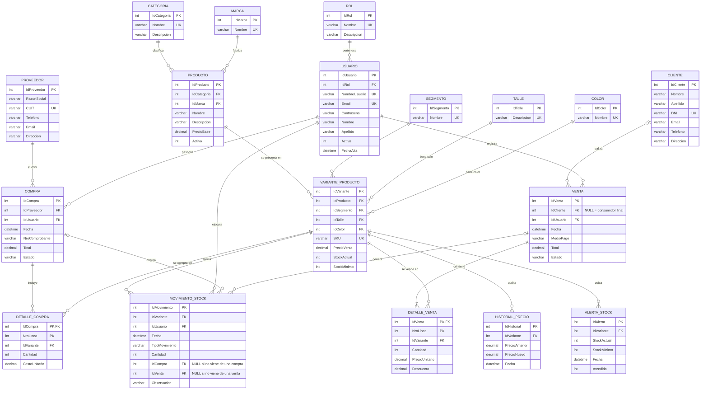

# 6. Diagrama Entidad-Relación

El diagrama usa notación de "pata de gallo" (*crow's foot*). Cada extremo de una relación indica la cardinalidad y la participación:

| Símbolo | Significado |
|---|---|
| `\|\|` | Exactamente uno (participación obligatoria) |
| `o\|` | Cero o uno (participación opcional) |
| `\|{` | Uno o muchos (participación obligatoria) |
| `o{` | Cero o muchos (participación opcional) |

La imagen `docs/DER.png` es el render del diagrama de abajo. Si cambia el modelo, se actualiza el bloque Mermaid y se vuelve a exportar la imagen.

## Entidades

| Entidad | Tipo | Identificador |
|---|---|---|
| Rol, Categoria, Marca, Segmento, Talle, Color | Fuerte (referencia) | Id propio |
| Usuario, Producto, Proveedor, Cliente | Fuerte | Id propio |
| VarianteProducto | Fuerte | `IdVariante` (claves alternativas: `SKU` y la combinación producto + segmento + talle + color) |
| Compra, Venta, MovimientoStock | Fuerte (transaccional) | Id propio |
| **DetalleCompra** | **Débil**, depende de `Compra` | `IdCompra` + `NroLinea` |
| **DetalleVenta** | **Débil**, depende de `Venta` | `IdVenta` + `NroLinea` |
| HistorialPrecio, AlertaStock | Fuerte (auditoría) | Id autonumérico |

`DetalleCompra` y `DetalleVenta` son **entidades dependientes**: una línea no tiene sentido sin su cabecera, y su identificador incluye el de la cabecera (`NroLinea` solo es único dentro de cada compra o venta).

## Relaciones, cardinalidad y participación

| Relación | Cardinalidad | Participación |
|---|---|---|
| Rol – Usuario | 1 : N | Todo usuario tiene un rol (obligatoria). Un rol puede no tener usuarios |
| Categoría – Producto | 1 : N | Todo producto tiene una categoría (obligatoria) |
| Marca – Producto | 1 : N | Todo producto tiene una marca (obligatoria) |
| Producto – Variante | 1 : N | Toda variante pertenece a un producto (obligatoria). Un producto recién creado puede no tener variantes todavía |
| Segmento / Talle / Color – Variante | 1 : N | Toda variante tiene un segmento, un talle y un color (obligatoria) |
| Proveedor – Compra | 1 : N | Toda compra tiene un proveedor (obligatoria) |
| Compra – DetalleCompra | 1 : N | Toda línea pertenece a una compra. Una compra pendiente puede no tener líneas todavía, pero no se puede recibir sin líneas |
| Cliente – Venta | 1 : N | **Opcional del lado de la venta**: una venta puede no tener cliente (consumidor final) |
| Venta – DetalleVenta | 1 : N | Toda venta tiene **al menos una** línea (lo garantiza `SP_RegistrarVenta`) |
| Variante – DetalleVenta / DetalleCompra | 1 : N | Toda línea refiere a una variante (obligatoria) |
| Usuario – Venta / Compra / Movimiento | 1 : N | Toda operación tiene el usuario que la registró (obligatoria) |
| Variante – Movimiento | 1 : N | Todo movimiento afecta a una variante (obligatoria) |
| Compra / Venta – Movimiento | 1 : N | **Opcional**: un movimiento proviene de una compra, de una venta o de ninguna (ajuste), pero nunca de ambas |
| Variante – HistorialPrecio / AlertaStock | 1 : N | Cada registro pertenece a una variante (obligatoria) |

## Relación ternaria resuelta en VarianteProducto

La variante es la intersección de **producto, segmento, talle y color**. No se modeló como relaciones binarias separadas (producto–talle, producto–color) porque lo que se vende y se stockea es una **combinación concreta**: puede existir la remera en M negra y en L blanca sin que exista la L negra. Esto se justifica formalmente en la [sección 7, formas normales 4 y 5](07_normalizacion.md#cuarta-forma-normal-4fn).
